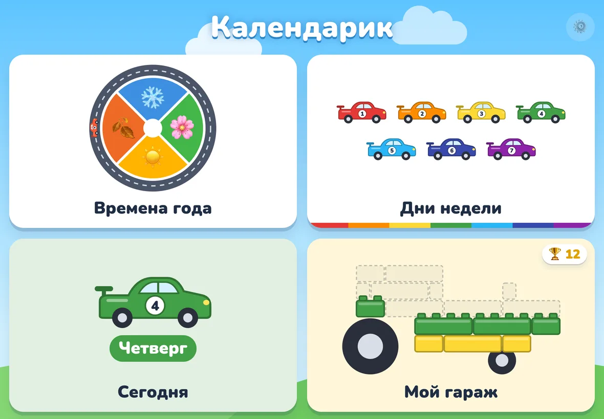
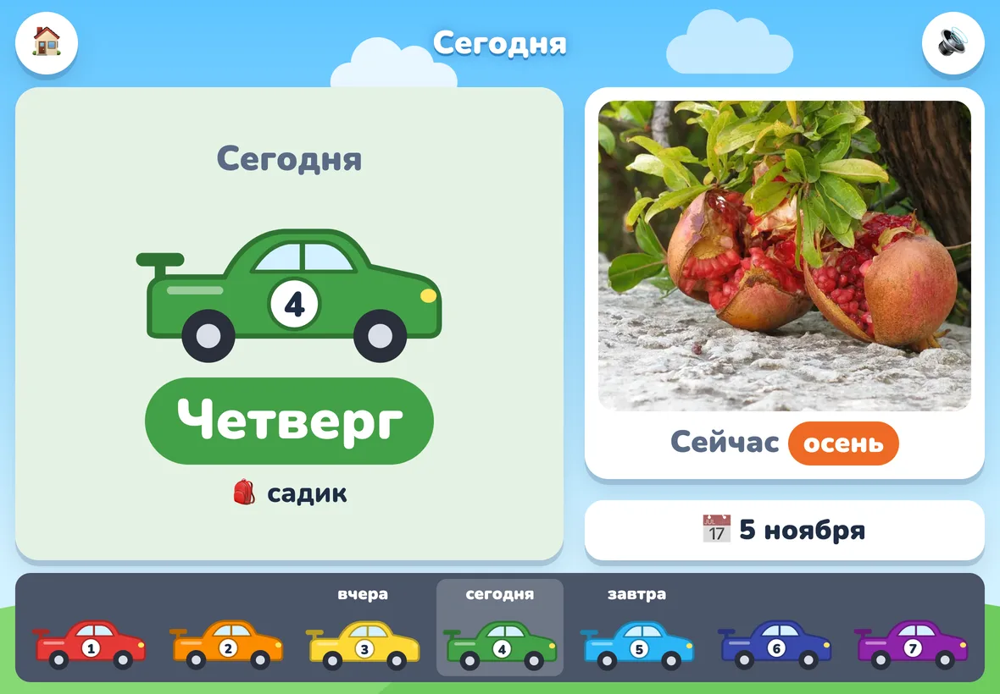
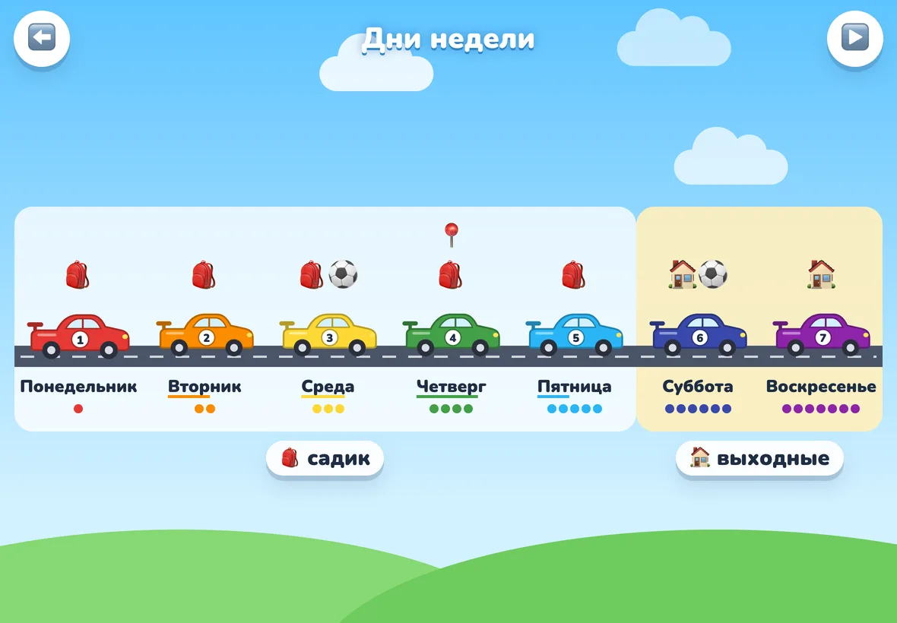
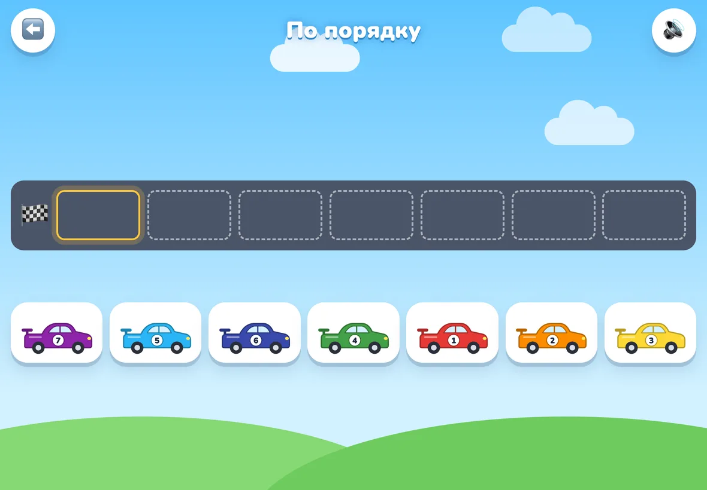
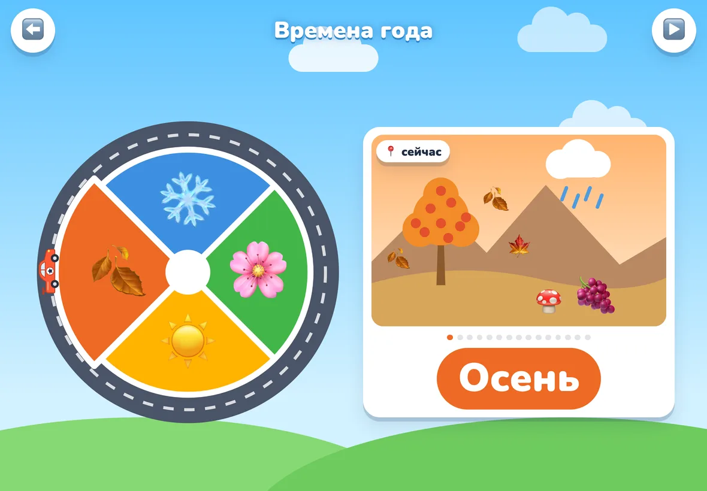
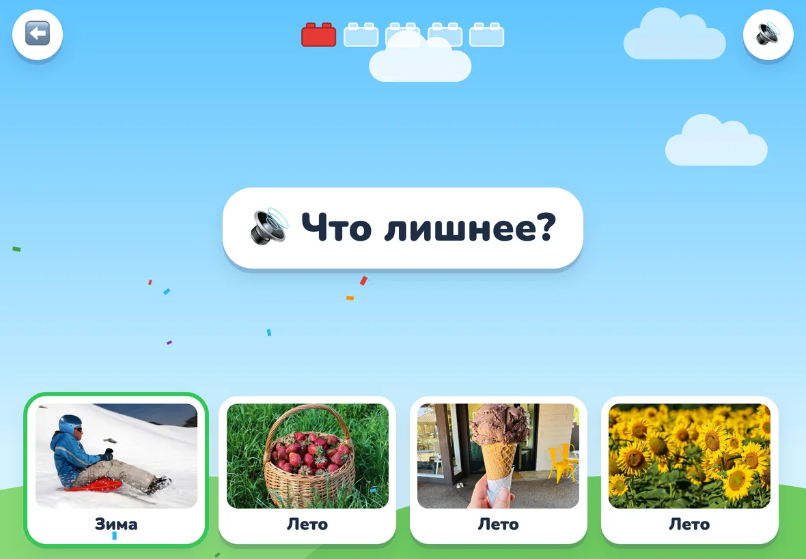
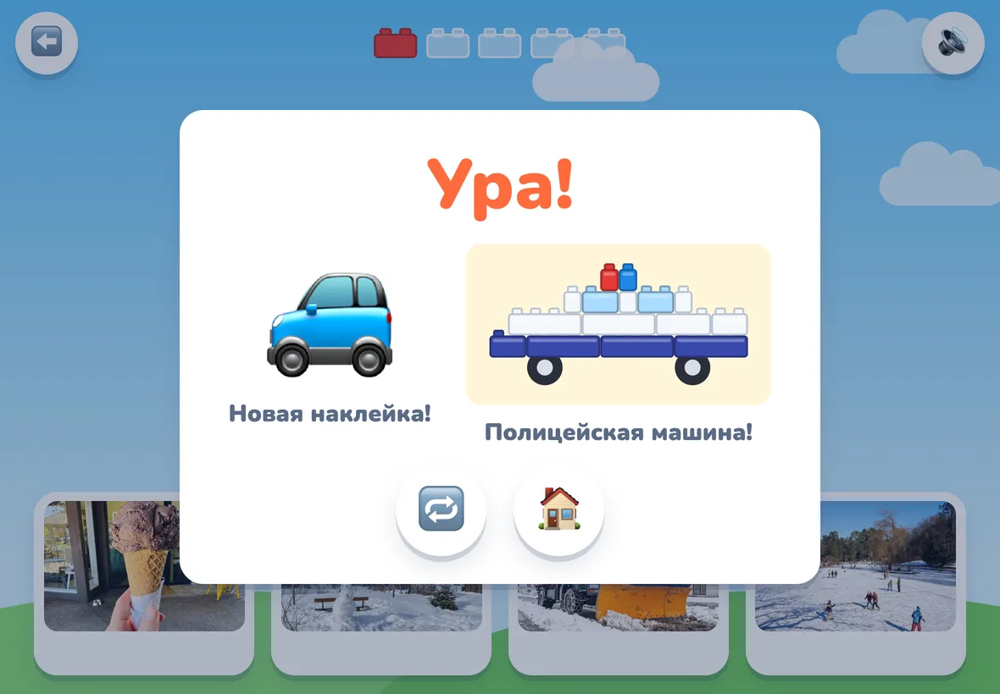
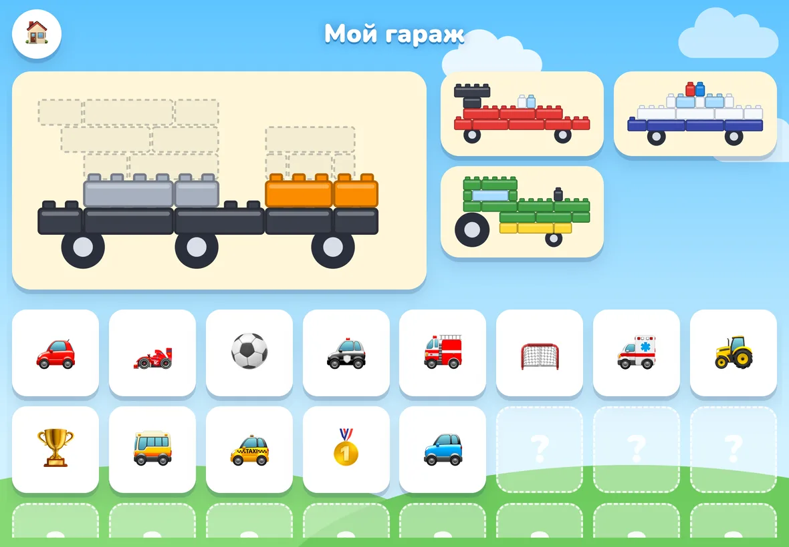

# Календарик

Маленькое приложение-игра, которое помогает детям 4–6 лет выучить по-русски **времена года**, **месяцы** и **дни недели**: названия, порядок и что когда бывает.

Сделано для детей, которые растут с двумя языками и слышат русский в основном дома. Опора на зрительную память, игру и голос родителя.

**Открыть:** https://vyegres.github.io/kalendarik/

<table>
  <tr>
    <td width="50%"><br>Главный экран</td>
    <td width="50%"><br>«Сегодня» — утренний ритуал</td>
  </tr>
  <tr>
    <td><br>Дни недели: машинки 1–7, садик и выходные</td>
    <td><br>Поставь машинки по порядку</td>
  </tr>
  <tr>
    <td><br>Круг года</td>
    <td><br>«Что лишнее?»</td>
  </tr>
  <tr>
    <td><br>Конец раунда: наклейка и достроенная модель Лего</td>
    <td><br>«Мой гараж»: модели и наклейки</td>
  </tr>
</table>

## Как учит

- **Дни недели — гоночные машинки цветов радуги** с номером на двери: понедельник — красная №1, воскресенье — фиолетовая №7. Цвет и номер помогают запомнить порядок.
- **Подсказки постепенно исчезают:** 🔢 цифры → 🏷️ подписи → 🎨 только цвета → ⚪ серые машинки, которые узнаются только по названию дня. Раунд почти без ошибок переводит на следующую ступеньку, трудный возвращает назад. Родитель может переключить ступеньку вручную.
- **Подсказки в самих словах:** ВТОРник — второй, ЧЕТВЕРг — четвёртый, ПЯТница — пятый, СРЕДа — середина.
- **Связь с жизнью:** будни — садик 🎒, выходные — дома 🏠, свои занятия (например, ⚽ футбол).
- **Времена года — круг**, по которому едет машинка: зима → весна → лето → осень → снова зима.
- **Много картинок на каждое время года:** нарисованная сцена и 11–14 фото — снеговик, санки, снегоуборочная машина, подснежники, утята, море, фургон с мороженым, золотой лес, ёжик… Тап по картинке показывает следующую, голос называет время года и что на фото. В играх картинки каждый раз другие, чтобы узнавалось само время года, а не одна картинка.
- **Месяцы — второе кольцо круга года:** 12 месяцев с номерами, по три вокруг своего времени года, от светлого к тёмному оттенку. Машинка едет по месяцам так же, как по временам года. У каждого месяца одна постоянная картинка (январь — снеговик, май — одуванчики, декабрь — ёлка), чтобы картинка и название запомнились вместе.
- **Опора на дни рождения:** месяцы запоминаются через своих людей — в январе день рождения у мамы, в марте у самого ребёнка, в сентябре у папы, в ноябре у сестры. На кольце и карточках у этих месяцев стоит лицо (фото или эмодзи) и 🎂. В рассказах о месяцах ещё три праздника: 💐 8 Марта, 🥚 Пасха (обычно в апреле), 🎄 Новый год.
- **Экран «Сегодня»** для утреннего ритуала: какой сегодня день, какой был вчера и будет завтра, какое сейчас время года и месяц и чей в нём день рождения.

## Игры

- **Дни недели:** смотреть, найди («Где пятница?»), расставь по порядку, кто пропал, вчера и завтра.
- **Времена года:** смотреть, найди, собери круг, что лишнее (три фото одного времени года и одно другого; сначала противоположные — зима и лето, потом любые).
- **Месяцы:** смотреть (тап по месяцу — рассказ о нём, ▶️ — «парад»: машинка проезжает весь год, голос называет месяцы по порядку, как считалку), поехали по году (машинка стоит на месяце, следующий спрятан за «?» — какой месяц потом? Машинка запоминает, где остановилась, и за несколько раундов проезжает весь год), собери время года (три месяца одного времени года поставить по порядку: декабрь → январь → февраль) и «Чей день рождения?» («Чей день рождения в январе?» — выбрать человека, «Когда день рождения у папы?» — выбрать месяц).

Ребёнку не нужно уметь читать: всё озвучено и показано картинками. Ошибки не наказываются — «Попробуй ещё!», а после двух ошибок правильный ответ начинает подсказывать себя. Чаще спрашивается то, что даётся труднее.

**Награды.** Каждый правильный ответ — кирпичик Лего. Кирпичики сами складываются в модель: гоночная машина, полицейская, трактор, самосвал, автобус, пожарная машина, праздничный торт, потом по кругу заново. Ещё не поставленные кирпичики видны пунктиром, так что заметно, сколько осталось. После раунда новые кирпичики со щелчком встают на место, а когда модель готова, голос называет её. За каждый раунд — ещё и наклейка. Модели и наклейки лежат в «Моём гараже» на главном экране.

## Голос родителя

Все 151 фразу можно записать своим голосом: ⚙️ в углу главного экрана, удерживать 1,5 секунды. Пока фраза не записана, её читает синтезатор речи.

Записи хранятся только на устройстве и никуда не отправляются. Их можно сохранить в файл и перенести на другое устройство: ⚙️ → «Сохранить в файл» / «Загрузить из файла».

## Семья

⚙️ → «Семья»: фото для мамы, папы, сестры и самого ребёнка (камера или галерея) и имена так, как их называет ребёнок; фразы вроде «Когда день рождения у …?» подстраиваются под имя. В коде записаны только месяцы и слова «мама», «папа», «сестра», «ты» — фото и имена хранятся на устройстве и переносятся в том же файле, что и голос.

## Установка на iPad

Открыть ссылку в Safari → «Поделиться» → «На экран Домой». После первого запуска работает без интернета.

## Для разработчиков

Код — ES-модули в `src/`, собираются [Vite](https://vite.dev) в `dist/`. Зависимостей во время работы нет, Vite нужен только для разработки и сборки.

```bash
npm install
npm run dev       # http://localhost:5173, с iPad в той же сети — по адресу ноутбука
npm run build     # сборка в dist/
npm run preview   # посмотреть сборку
```

Что где:

- `src/data.js` — дни недели, времена года и месяцы: названия, цвета, рассказы, дни занятий, фото к временам года (`DAYS`, `SEASONS`, `MONTHS`, `PICS`, `MIXED` — фото, которые не берутся в «Что лишнее?»), чьи дни рождения и праздники в каких месяцах (`FAMILY`, `HOLIDAYS`), модели Лего (`MODELS`, нарисованы буквами);
- `src/family.js` — имена и фото семьи из режима родителя (только на устройстве) и что голос говорит про месяц;
- `src/phrases.js` — все фразы, которые можно озвучить своим голосом;
- `src/screens/` — экраны и игры, у каждого рядом свой `.css`; таблица режимов викторины — `quiz-modes.js`;
- `src/learning.js` — какие вопросы задавать чаще и когда убирать подсказки;
- `src/audio/` — звуки, синтезатор речи, запись и хранение голоса родителя;
- `src/draw/` — SVG-рисунки: машинки, кирпичики, модели Лего (`lego.js`), круг времён года и круг месяцев (`year.js`), карточки месяцев (`month.js`), сцены времён года и выбор фото к ним;
- `src/assets/seasons/` — фото времён года (800×520, WebP) с Wikimedia Commons; авторы и лицензии — в `CREDITS.md` рядом;
- `src/ui/` — переходы между экранами, конфетти, праздник после раунда;
- `src/sw.js` — работа без сети; список файлов и версию кэша подставляет сборка (`vite.config.js`).

Сайт собирается и публикуется на GitHub Pages автоматически при пуше в `main` (`.github/workflows/deploy.yml`).

Запись с микрофона работает только по https или на `localhost`. Файл с голосом `kalendarik-golos.json`, положенный в корень проекта, `npm run dev` отдаёт iPad'у так же, как раньше.
